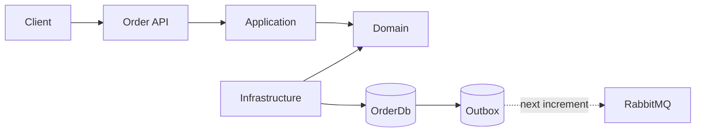
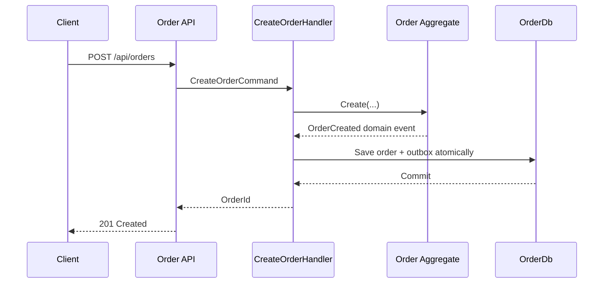

# Event-Driven Order Platform

An incremental, local-first reference implementation using .NET 10 and C# 14. The current increment delivers the shared domain/event contracts and the complete Order service foundation. Later services are intentionally not scaffolded until this module passes its build and tests.

## Current module

- Clean Architecture projects: API, Application, Domain, Infrastructure, Contracts
- DDD order aggregate, entity, value object, repository abstraction, and domain events
- CQRS commands/queries through MediatR with structured logging behavior
- EF Core SQL Server persistence with transactional Outbox and Inbox schemas
- Versioned public integration-event contracts with correlation and causation metadata
- Problem Details, health checks, OpenAPI/Swagger, HTTPS redirection, and Serilog
- Unit and architecture tests
- Local SQL Server, RabbitMQ, Redis, and Order API containers

RabbitMQ publishing, retry/DLQ processing, saga orchestration, JWT/rate limiting, Redis caching, and remaining services belong to subsequent increments. They are not falsely represented as complete here.

## Architecture



## Create-order sequence



## Run and verify

```powershell
dotnet restore EventDrivenOrderPlatform.slnx
dotnet build EventDrivenOrderPlatform.slnx --no-restore
dotnet test EventDrivenOrderPlatform.slnx --no-build
Copy-Item .env.example .env
docker compose up --build
```

Swagger is available at `http://localhost:5101/swagger`; health is `http://localhost:5101/health`. Replace the example SQL password in `.env` for local use. The password checked into `appsettings.json` is explicitly local-only and must never be reused outside this repository.

### API

- `POST /api/orders` creates an order.
- `GET /api/orders/{id}` reads an order.
- `POST /api/orders/{id}/cancel` cancels an eligible order.

Example request:

```json
{
  "customerId": "customer-1001",
  "currency": "USD",
  "items": [{ "productId": "sku-101", "productName": "Mechanical Keyboard", "quantity": 1, "unitPrice": 89.99 }]
}
```
