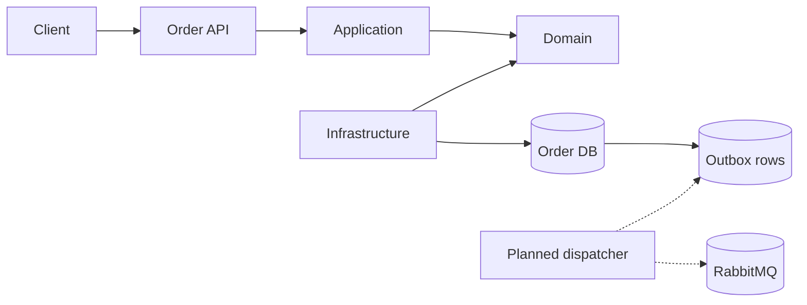

# Architecture

The repository currently implements only the Order bounded context. Clean Architecture keeps domain rules independent from transport and persistence, while the database transaction stores the aggregate and domain-event outbox rows together.

| Concern | Current state | Next production step |
| --- | --- | --- |
| Domain consistency | Order aggregate and optimistic version token | Add concurrency-conflict API mapping and tests. |
| Messaging | Outbox and inbox persistence models | Add a dispatcher, public-event mapping, confirms, retry, and poison handling. |
| Data lifecycle | Development uses `EnsureCreated` | Commit reviewed EF migrations and deployment bundles. |
| Security | No identity boundary in this increment | Add standards-based identity, least-privilege policies, and abuse controls. |
| Operability | Logs and basic health endpoint | Add dependency readiness, traces, metrics, dashboards, and SLOs. |

